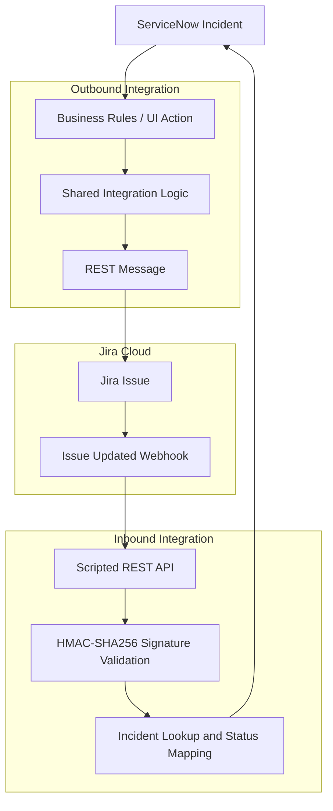

# ServiceNow–Jira Bidirectional Integration

This project implements a bidirectional integration between ServiceNow and Jira Cloud, connecting IT service management with development work tracking. It establishes a structured relationship between ServiceNow Incidents and Jira issues, enabling information to flow between the two platforms while preserving their distinct roles in incident management and work tracking.

## Technologies Used

- **Platforms:** ServiceNow, Jira Cloud
- **Languages & Data Formats:** JavaScript, JSON, Atlassian Document Format (ADF)
- **ServiceNow Development:** Business Rules, Script Includes, UI Actions, Scripted REST APIs
- **REST Integration:** REST Messages, `sn_ws.RESTMessageV2`, Jira Cloud REST API v3, Webhooks
- **Security:** Basic Authentication, HMAC-SHA256

## Business Scenario & Problem Statement

ServiceNow is used to manage IT Incidents, while Jira Cloud is used to track related development work. When an Incident requires further investigation or a fix through Jira, the two platforms need a reliable way to associate their records and exchange relevant updates.

Without an integration, creating corresponding Jira issues and keeping related information aligned can require manual effort. This can lead to duplicated work, inconsistent information across platforms, and limited visibility into the progress of related Jira issues from ServiceNow.

This project addresses these challenges by establishing a controlled integration between ServiceNow Incidents and Jira Cloud, with defined data exchange and status synchronization rules.

## Project Objectives

- **Automated Issue Creation:** Create Jira issues automatically for qualifying high-priority Software Incidents and support manual creation for lower-priority Software Incidents.
- **Record Correlation:** Store the Jira Issue Key on the ServiceNow Incident to maintain a link between the two records.
- **Outbound Data Synchronization:** Send selected Incident field changes to the corresponding Jira issue.
- **Inbound Status Synchronization:** Process Jira webhook events and update the related ServiceNow Incident State for supported Jira statuses.
- **Secure Webhook Processing:** Validate incoming webhook signatures using HMAC-SHA256 before processing the payload.

## Architecture Diagram

The integration connects ServiceNow and Jira Cloud through two workflows: outbound communication for creating and updating Jira issues, and inbound communication for processing Jira webhook events and synchronizing supported status changes.

## Outbound Integration Workflow

The outbound workflow connects ServiceNow Software Incidents with Jira Cloud by creating Jira issues for qualifying Incidents. P1 Critical and P2 High Incidents are processed automatically, while P3 Moderate and P4 Low Incidents support manual issue creation through a UI Action. Both paths use shared integration logic to create the Jira issue and store its key on the related Incident.

Success and failure information is recorded in the Incident work notes, and integration errors are logged for troubleshooting.

## Inbound Integration Workflow

The inbound workflow processes Jira issue update webhooks to synchronize supported Jira statuses with the related ServiceNow Incident. Incoming requests are validated using HMAC-SHA256 signature verification before the payload is processed, and the Jira Issue Key is used to identify the corresponding Incident.

Supported statuses are mapped to ServiceNow Incident states, while the Jira `Done` status is intentionally excluded from automatic state mapping to avoid an unsupported resolution transition.

## Authentication & Webhook Security

The integration uses Basic Authentication for outbound ServiceNow-to-Jira REST requests and HMAC-SHA256 signature verification for inbound Jira webhooks. The shared webhook secret is stored in a password-type ServiceNow system property and is used to validate incoming webhook signatures before processing the payload.

## Testing & Verification

The integration was tested across outbound Jira issue creation, updates to selected fields, inbound webhook processing, and ServiceNow Incident state synchronization. Testing also covered webhook signature validation, error handling, and supported status mappings.

The verification process included testing both successful operations and failure scenarios to assess the integration’s behavior under different conditions.

